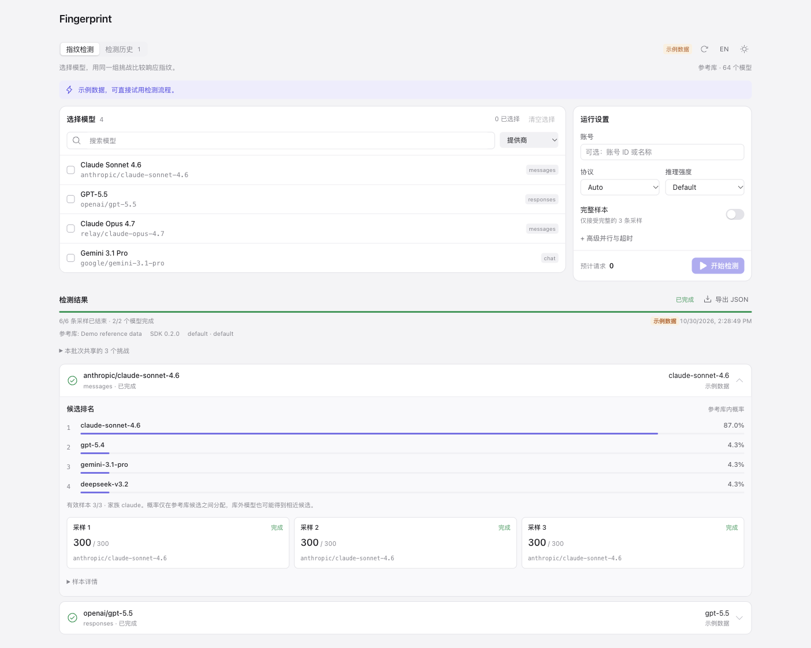

# Magpie Fingerprint

[简体中文](README.zh-CN.md) · [Magpie](https://github.com/yetone/magpie) · [lm-detector](https://github.com/Ikaleio/lm-detector)

Numeric model-fingerprint diagnostics as a Magpie page plugin. It samples a
selected text model through Magpie, runs the pinned `lmfpd-sdk` detector, and
shows evidence with uncertainty. It is a diagnostic signal, not identity
authentication.



- Select up to 24 models across providers, with the same three challenges per batch.
- Reuse Magpie authentication and native endpoint metadata; optionally pin an account.
- Follow live sample counts, cancel work, and inspect the actual response route.
- Compare ranked candidates, including partial and unscorable outcomes.
- Keep raw replies and data versions in local history; export or copy JSON.
- Magpie's native page bridge, controls and design tokens; follows the host's theme and language.
- Compact model lists, keyboard-accessible view tabs, and narrow-screen layouts.

## Install from GitHub

This repository ships its built `dist/` files. In Magpie, install the GitHub
repository `github:KaranocaVe/magpie-fingerprint` from **Plugins** and enable the
Fingerprint page. Use a current Magpie release with `page.service` support and Bun 1.4.2+.

Or use the CLI:

```sh
magpie plugin add github:KaranocaVe/magpie-fingerprint
```

Open **Fingerprint** in the sidebar, or choose **Fingerprint** from a provider's menu.
Starting a detection sends three requests per selected model and uses that provider's quota.

## Development

```sh
bun install --frozen-lockfile
bun run check
bun start
```

The plugin page service listens on `3488` by default and uses Magpie's gateway
at `http://127.0.0.1:3425`. See [integration.md](integration.md) for gateway
authentication, `magpie web`, environment variables, and the explicit `--demo`
fixture.

## Scope and limits

The first release supports numeric fingerprinting. A run uses a pinned
reference version, three shared challenges per batch, bounded work, and
cancellation. It records proposed, observed, and failed evidence separately;
it does not prove provider identity, authenticate a model, or infer hidden
tokenizers. `--demo` runs an isolated illustrative workflow without model calls.

Magpie middleware and protocol adapters still apply. A changed actual provider/model
invalidates that target's aggregate score. Account pinning is optional; it does not
turn a routed channel into an upstream identity guarantee. Tokenizer probing is deferred.

MIT licensed. Third-party notices are in [THIRD_PARTY_NOTICES.md](THIRD_PARTY_NOTICES.md).
